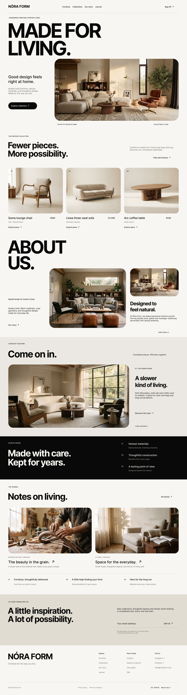

# NÓRA FORM — Furniture Landing Page

A modern furniture e-commerce landing page concept designed around timeless pieces, natural materials, and a calm editorial aesthetic.

## Website Preview



## Overview

NÓRA FORM is a furniture website concept that presents a curated collection of contemporary furniture through a clean, editorial-style layout. The design combines oversized typography, warm neutral colors, generous whitespace, and high-quality interior photography to create a refined and welcoming experience.

## Design Highlights

- **Minimalist visual identity:** A warm off-white background, dark typography, and restrained details.
- **Editorial typography:** Large, bold headlines create a strong visual hierarchy.
- **Product showcase:** A curated furniture collection with product names, prices, and exploration links.
- **Brand storytelling:** Dedicated sections introduce the brand, its design philosophy, and its approach to craftsmanship.
- **Journal section:** Editorial content supports the brand story and gives visitors more ways to explore.
- **Newsletter area:** A simple subscription section invites visitors to stay connected.
- **Responsive-minded layout:** Content is organized into clear sections that can adapt to different screen sizes.

## Page Sections

1. **Hero** — Brand introduction and a prominent interior image.
2. **Featured Collection** — Selected furniture pieces with product details.
3. **About Us** — Brand story and design philosophy.
4. **Room Inspiration** — Interior imagery and lifestyle-focused content.
5. **Brand Values** — A concise presentation of materials, construction, and longevity.
6. **Journal** — Articles and inspiration related to furniture and everyday living.
7. **Newsletter** — Email subscription call to action.
8. **Footer** — Navigation, support links, and social channels.

## Getting Started

Clone the repository:

```bash
git clone <your-repository-url>
cd <your-project-folder>
```

Install dependencies and start the development server using the package manager configured in the project:

```bash
npm install
npm run dev
```

Then open the local URL shown in your terminal.

## Project Status

This project is currently a website design and development showcase. The live demo and repository links can be added here once the project is published.

## Notes

The screenshot is stored in the `assets` directory. Keep this folder alongside `README.md` so the preview image renders correctly on GitHub.
